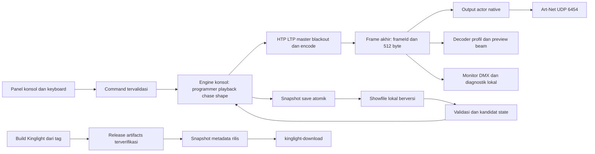

# Arsitektur Kinglight

Status: proposal 2026-11-26. Implementasi belum dimulai.

## Aliran data

Preview tidak mempunyai panah kembali ke buffer DMX. Mengubah posisi fixture di stage mengubah model penempatan preview melalui command terpisah, bukan channel pan/tilt fixture.

## Pilihan stack

| Pilihan | Susunan | Kelebihan untuk target video | Biaya dan batas |
|---|---|---|---|
| A, rekomendasi | Tauri 2, Rust engine/output, Three.js preview, Vite dengan frontend pilihan pemilik | Ownership output native jelas; tooling beam, camera dan instancing tersedia; renderer terpisah dari loop UDP | Rust toolchain belum tersedia pada pemeriksaan awal; perlu WebView2 dan pembuktian IPC/render pada Windows |
| B | Python, PySide6, QOpenGLWidget dengan renderer GPU yang dibuktikan lewat spike | Kontrol desktop padat dan pola Qt dikenal dari referensi lokal; runtime Python tersedia | GIL dan embedding OpenGL perlu dibuktikan; engine/output lebih baik dipisah proses jika renderer Python mengganggu timing |
| C, pembanding | Electron, Three.js, output melalui utility process | Satu ekosistem JS untuk UI dan tooling | Paket dan memori perlu diukur; renderer tidak boleh mendapat akses Node/network native langsung |

Rekomendasi frontend opsi A: React dengan TypeScript, karena kebutuhan panel stateful dan ekosistem tooling. Vue, Svelte, atau frontend tanpa framework tetap pilihan sah. Jangan scaffold sampai pemilik memilih. Versi stable dan kecocokan toolchain diperiksa ulang saat fase implementasi, tidak ditebak dari nama tahun.

Portal tidak memerlukan SSR aplikasi atau backend. Astro statis direkomendasikan bila dokumentasi bertambah; HTML/CSS/TypeScript statis cukup untuk portal kecil. Tidak perlu memilih framework yang sama dengan desktop hanya untuk berbagi warna dan metadata.

## Ownership

| Komponen | Memiliki | Tidak memiliki |
|---|---|---|
| Console engine | State otoritatif, revision command, programmer, playback, phase, resolved frame | Widget, DOM, camera, socket |
| Output actor | Socket, NIC, target, Port-Address, pacing, sequence, status armed | Editor show atau operasi file yang memblokir loop |
| Preview | Scene GPU, fixture pose, camera, kualitas beam, snapshot terakhir | Clock engine, socket, nilai show otoritatif |
| Persistence | Validasi schema, profile pinning, atomic save, migrasi | Pengaktifan output atau perubahan state parsial |
| UI | Fokus, seleksi, drag, representasi state, command | Salinan buffer yang dapat menjadi sumber output alternatif |
| Release producer | Versi dan artifact manifest aplikasi | Halaman portal yang menulis ulang angka versi |
| Portal | Metadata terverifikasi, unduhan, panduan | Menjalankan UDP atau memasang update ke aplikasi |

Satu engine menghasilkan frame. Actor output dapat menyimpan snapshot immutable terakhir untuk pacing; snapshot itu tidak boleh menjadi state editable kedua.

## Loop dan antrean

- Gunakan monotonic clock dan deadline absolut. Setelah stall, hitung phase dari waktu, jangan replay semua tick lama ke jaringan sebagai burst.
- Latest-wins untuk drag fader pada key yang sama. Record/clear/patch memakai command berurutan dan acknowledgement.
- Blackout mempunyai jalur prioritas dan latch. Snapshot yang dibuat sebelum perubahan latch tidak boleh mengalahkan blackout yang lebih baru.
- UI telemetry dapat di-coalesce. Tidak diperlukan satu pesan IPC per channel per frame.
- Pause Preview hanya menghentikan pembaruan gambar. Engine, clock show dan pengiriman tetap berjalan; indikatornya wajib jelas.
- Minimize/hidden menurunkan atau menghentikan render. Tidak boleh menghentikan output.
- File dialog, hashing, cek update dan load show tidak dikerjakan di loop output.

## Batas Art-Net

Proposal awal mengirim full frame 512 byte dengan 256 slot konsol aktif. Slot 257..512 nol pada profil tersebut. Buffer fisik 512 tidak menambah kapasitas konsol menjadi 512.

Port-Address adalah angka raw 15-bit, tidak memakai penambahan satu tersembunyi. Mode baru mengikuti rentang spesifikasi 1..32767. Raw address 0 disediakan sebagai pilihan kompatibilitas yang eksplisit; default jaringan belum dikunci sebelum node pertama diketahui. Angka universe di UI QLC+ tidak boleh dianggap identik dengan angka pada paket.

Tahap pertama memakai unicast manual untuk penerima uji/receiver yang diketahui. ArtPoll/ArtPollReply dan subscription menjadi gerbang sebelum mengklaim dukungan controller Art-Net 4 lengkap. Spesifikasi revisi yang dibaca melarang broadcast ArtDmx; broadcast warisan hanya dapat ditambahkan sebagai mode kompatibilitas terpisah jika node yang diuji memerlukannya. Limited broadcast 255.255.255.255 bukan default.

Sequence per Port-Address bergerak 1..255 lalu kembali 1. Frame selalu 530 byte pada payload 512. UDP send sukses bukan acknowledgement penerima. Hanya satu instance Kinglight boleh menguasai output aktif untuk konfigurasi lokal yang sama; tabrakan dengan aplikasi lain dijelaskan, tidak diklaim dapat dideteksi sempurna.

## Preview bertahap

Spike wajib memperlihatkan beam bergerak sebelum membangun seluruh panel. Tahap awal menggunakan cone mesh/shader, additive blending yang terkontrol, floor intersection, clipping, pan/tilt calibration, dan quality setting. Tidak ada klaim nilai lux atau kesesuaian photometric.

Renderer menerima frame yang sudah di-encode, lalu mendekode memakai profile/mode patch yang sama. Ini membuat kesalahan coarse/fine atau master juga terlihat di monitor dan preview. Model visual dapat menghaluskan gerak tampilan, tetapi tidak mengubah sample output atau state cue.

## Penyimpanan dan antarmuka lokal

Gunakan satu berkas `.kinglight` berupa JSON berversi untuk show, serta preferensi lokal terpisah. Tidak ada database server, akun, token cloud, API HTTP publik, atau local bridge browser pada versi awal.

Kontrak command, model dan batas validasi ada di [ENGINE-CONTRACT.md](docs/ENGINE-CONTRACT.md) dan [ERD.md](ERD.md). Untuk opsi Tauri, command IPC Rust bertipe dan capability minimal; untuk opsi Python, pesan proses terstruktur. UI web tidak diberi API socket generik.

## Keputusan dan alasannya

| Keputusan | Status | Alasan |
|---|---|---|
| Dua repo independen dengan kontrak release | Ditetapkan pemilik | Desktop dan distribusi berkembang terhubung tanpa saling menjadi runtime dependency |
| Repo publik pada tiga platform | Ditetapkan pemilik | Riwayat sumber tersedia pada GitLab, Codeberg, GitHub |
| Referensi lain read-only | Ditetapkan pemilik | Pekerjaan agen lain tidak boleh terganggu |
| Preview beam bagian inti | Diturunkan dari video, untuk tinjauan | Demonstrasi video berpusat pada shape yang langsung terlihat sebagai gerakan beam |
| Engine dan output terpisah dari render | Proposal | Stall GPU/UI tidak boleh menentukan jadwal UDP |
| JSON lokal berversi | Proposal | Show kecil dan portabel tanpa kebutuhan server database |
| Tauri + Rust + Three.js | Direkomendasikan, belum dipilih | Mendukung preview GPU serta ownership output native |
| Enam page software | Proposal | Video menampilkan enam selector, berbeda dari lima page di manual |
| Manual update lebih dahulu | Proposal | Release awal dapat diverifikasi sebelum menambah installer updater otomatis |

## Risiko yang menentukan urutan kerja

| Kegagalan | Mitigasi yang harus dibuktikan |
|---|---|
| Preview bagus tetapi tidak cocok dengan byte ke node | Frame akhir tunggal, decoder profile yang sama, uji byte dan stage pose |
| Fader/page terlihat benar tetapi state programmer salah | State machine dan replay command sebelum panel lengkap |
| Blackout tertunda oleh drag atau render | Latch prioritas, antrean bounded, benchmark loopback di bawah beban |
| LTP pan/tilt kembali ke snapshot lama setelah flash | Release menghitung ulang layer yang masih hidup, bukan restore salinan lama |
| Mismatch channel count/profil hardware | Profil varian eksplisit dan batas patch diuji |
| Portal menunjuk installer yang belum selesai diunggah | Asset immutable diverifikasi dahulu, metadata portal dipublikasikan terakhir |
| Instalasi atau lisensi ternyata tidak sesuai | Spike toolchain/installer dan pencatatan lisensi sebelum memperluas UI |

Biaya infrastruktur tetap berupa build/release dan hosting statis yang dipilih nanti. Tidak ada langganan layanan atau estimasi biaya yang sudah disetujui.
