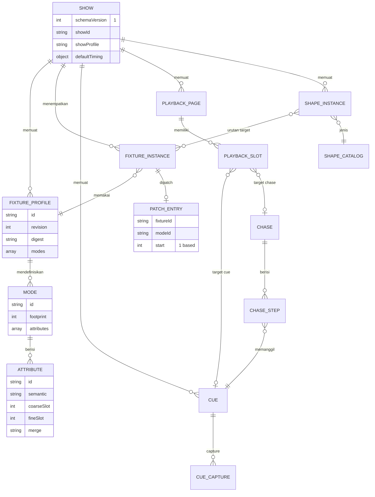

# ERD Kinglight, usulan kontrak data

Status: draf untuk ditinjau pemilik. Rujukan: [PRD](PRD.md), [BLUEPRINT](BLUEPRINT.md), [ENGINE-CONTRACT](docs/ENGINE-CONTRACT.md). Belum ada kode aplikasi.

## 1. Sumber dan batas klaim

| Kode | Pernyataan sumber | Perlakuan |
|---|---|---|
| F1 | Video VE Project: 54,33 s, 1080p, 30 fps. Label teramati: 16 tombol unit, enam selector playback page, 16 fader plus master, bank channel 1..16 dan 17..32 | Label tampak di video. Makna internal bank dan page belum terbukti |
| F2 | Manual KK-256: 16 tombol unit, kapasitas 12 fixture, 5 page kali 16 slot, 100 chase step, maksimum 32 channel per fixture | Fakta dokumen manual |
| F3 | Preview video menampilkan sekitar 12 beam putih | Observasi visual, bukan bukti jumlah fixture hardware |
| P1 | Enam page software menghasilkan 96 slot playback | Turunan video, masih usulan |
| P2 | Kinglight memakai 16 slot fixture UI. Angka ini terpisah dari kapasitas 12 fixture manual dan dari footprint DMX | Usulan |
| P3 | 256 channel aktif, buffer wire 512 | Usulan |
| P4 | Normal, Fine, Ultra adalah resolusi encoder UI, bukan mode fixture | Usulan |
| P5 | Delapan bentuk pan/tilt termasuk Circle dua arah sesuai K-07. Jumlah bentuk berbeda antarsumber vendor | Usulan produk, bukan angka manual tunggal |

Arti seperti 96 slot, pengelompokan 12 beam, dan parameter shape berasal dari keputusan desain. Label yang terlihat di video tidak dibaca sebagai spesifikasi firmware.

## 2. Perbandingan profil

| Atribut | Video, label teramati | Manual KK-256, dokumen | Keputusan yang diusulkan |
|---|---|---|---|
| Tombol unit | 16 | 16 | 16 slot fixture UI |
| Page playback | enam selector | 5 page | enam page bila profil video dipilih |
| Slot playback | tidak terbaca dari label | 80 | 96 slot bila enam page dipilih |
| Kapasitas fixture | tidak terbaca | 12 fixture | 12 tidak sama dengan 16 slot UI |
| Bank channel | 1..16 dan 17..32 | tidak diverifikasi | tampilan bank, bukan jumlah fixture |
| Fader | master plus 16 | tidak diverifikasi | 16 strip plus master |
| Chase step | tidak terbaca | 100 | baseline manual |
| Channel per fixture | tidak terbaca | maksimum 32 | batas patch |
| Beam putih | sekitar 12 | tidak relevan | target visual 12 beam |
| Bentuk pan/tilt | tidak terbaca semua | jumlah berbeda antarsumber | delapan bentuk termasuk Circle dua arah |

## 3. Diagram entitas

## 4. Kontrak field

### Show dan profil fixture

| Entitas | Field | Tipe | Aturan |
|---|---|---|---|
| SHOW | `schemaVersion` | int | nilai 1. Versi tidak dikenal ditolak atomik |
| SHOW | `showId`, `name` | string | identitas dan label show |
| SHOW | `showProfile` | enum | `videoSixPage` atau `manualBaseline`, menunggu pemilik |
| SHOW | `defaultTiming` | object | `chaseHoldMs`, `chaseFadeMs`, `shapePeriodMs`, satuan ms |
| SHOW | `migration` | object | wadah bertipe untuk migrasi schema kelak, bukan state runtime |
| FIXTURE_PROFILE | `id`, `revision`, `digest` | string, int, string | digest dihitung dari bytes kanonik profil |
| FIXTURE_PROFILE | `modes[]` | object[] | setiap mode punya `id`, `label`, `footprint`, `attributes[]` |
| FIXTURE_PROFILE | `safetyDefaults` | object | pemetaan `attributeId` ke nilai aman 16 bit |
| MODE | `footprint` | int | jumlah slot yang dipakai mode, turunan dari slot atribut |
| MODE | `attributes[]` | object[] | tiap atribut punya slot, rentang, nilai awal, aturan merge |
| ATTRIBUTE | `id` | string | stabil di dalam profil, dipakai cue dan fader |
| ATTRIBUTE | `semantic` | enum | `dimmer`, `red`, `green`, `blue`, `shutter`, `pan`, `tilt`, `zoom`, `colorWheel` |
| ATTRIBUTE | `coarseSlot`, `fineSlot` | int atau null | offset 1 based di dalam `footprint`. `fineSlot` ada bila atribut 16 bit |
| ATTRIBUTE | `range` | object | `min`, `max`, dan `center` opsional dalam ruang logis 16 bit |
| ATTRIBUTE | `default` | int | nilai awal dan nilai aman sesuai peran atribut |
| ATTRIBUTE | `merge` | enum | `HTP` untuk intensitas, `LTP` untuk atribut event, `DISCRETE` untuk roda warna |
| ATTRIBUTE | `capabilities` | object | `roles[]` dan `ranges[]` berisi `min`, `max`, `step`. Bukan daftar boolean |

Satu mode dengan banyak atribut wajib mencantumkan `attributes[]`. Tidak boleh ada satu `coarseSlot` tunggal untuk beberapa atribut. `capabilities` menyatakan peran dan rentang nilai yang benar benar didukung, bukan pasangan enum benar dan salah.

### Patch, cue, dan placement

| Entitas | Field | Tipe | Aturan |
|---|---|---|---|
| PATCH_ENTRY | `fixtureId`, `modeId` | string | mode harus milik profil fixture tersebut |
| PATCH_ENTRY | `start` | int | alamat DMX 1 based |
| PATCH_ENTRY | `footprint` | turunan | dihitung dari mode, tidak disimpan sebagai angka bebas |
| PATCH_ENTRY | `bank` | turunan | tampilan UI 1..16 atau 17..32, tidak disimpan |
| FIXTURE_INSTANCE | `id`, `profileId`, `profileDigest` | string | digest harus cocok dengan profil aktif |
| FIXTURE_INSTANCE | `label`, `slotUi` | string, int | `slotUi` 1..16 untuk panel |
| FIXTURE_INSTANCE | `position`, `units`, `axes` | object, string, object | `x`, `y`, `z`, satuan usulan m, sumbu usulan Z up dan Y forward |
| FIXTURE_INSTANCE | `calibration` | object | offset pan/tilt, inversion, skala derajat |
| CUE | `id`, `label` | string | satu cue dapat dipakai banyak slot dan step |
| CUE_CAPTURE | `fixtureId`, `attributeId`, `value16` | string, string, int | mask menurut fixture dan atribut, bukan offset channel |

Semua angka yang terlihat operator memakai basis satu: alamat DMX, slot playback, nomor step, dan urutan target. Indeks array internal tidak diekspos. Tidak ada field `selected` di showfile karena seleksi adalah state UI.

### Playback dan shape

| Entitas | Field | Tipe | Aturan |
|---|---|---|---|
| PLAYBACK_PAGE | `id`, `pageIndex` | string, int | 1 sampai 5 atau 1 sampai 6 sesuai profil |
| PLAYBACK_SLOT | `slotIndex` | int | 1 sampai 16 |
| PLAYBACK_SLOT | `targetKind`, `targetId` | enum, string | `cue` atau `chase`. Keduanya tidak boleh terisi sekaligus |
| PLAYBACK_SLOT | `target` | object | wadah opsional untuk opsi target lanjutan, bukan salinan state |
| CHASE | `id`, `label` | string | dimiliki show, bukan disimpan di dalam page |
| CHASE_STEP | `stepIndex` | int | 1 based |
| CHASE_STEP | `cueId`, `holdMs`, `fadeMs` | string, int, int | durasi ms, bukan jumlah tick engine |
| SHAPE_CATALOG | `kind`, `phaseParams` | enum, object | jenis dan tipe parameter untuk tiap bentuk |
| SHAPE_INSTANCE | `id`, `kind`, `owner` | string, string, string | `owner` dipakai arbitrasi prioritas engine |
| SHAPE_INSTANCE | `targets` | string[] | urutan fixture id dijaga, bukan kumpulan tanpa urutan |
| SHAPE_INSTANCE | `phaseParams` | object | hanya kunci yang didefinisikan katalog, bertype |
| SHAPE_INSTANCE | `durationMs` | int | durasi phase dalam ms, bukan jumlah tick |

Page memiliki slot. Slot menunjuk cue atau chase. Chase memiliki step. Tidak ada relasi langsung page ke step.

## 5. Katalog bentuk dan parameter phase

Delapan bentuk pan/tilt: `Circle`, `CircleTwoWay`, `Figure8`, `Spiral`, `Square`, `Diamond`, `PanSwing`, `TiltSwing`. `CircleTwoWay` adalah Circle dua arah, bukan varian tersembunyi.

| Bentuk | Parameter khusus bertype |
|---|---|
| Circle | `direction: cw|ccw` |
| CircleTwoWay | `direction: cw|ccw`, `turnMs: int` |
| Figure8 | `axis: pan|tilt`, `direction: cw|ccw` |
| Spiral | `turns: int`, `direction: cw|ccw` |
| Square | `size: int` |
| Diamond | `size: int` |
| PanSwing | `amplitude: int` |
| TiltSwing | `amplitude: int` |

Parameter bersama: `speed: number`, `bpm: int|null`, `spreadMs: int`, `repeat: int`, `interleave: bool`, `order: forward|reverse|oddEven`, `phaseMs: int`. Kunci di luar daftar ditolak. Semua durasi memakai ms pada file. Konversi ke tick terjadi di engine saat runtime.

## 6. Matriks validasi showfile

| Aturan | Pemeriksaan | Kode galat |
|---|---|---|
| Versi dikenal | `schemaVersion` sama dengan 1 | `UNSUPPORTED_SCHEMA` |
| Ukuran dan kedalaman | batas awal 10 MiB sesuai PRD, kedalaman JSON dibatasi | `FILE_TOO_LARGE` |
| JSON terbaca | syntax dan type sesuai kontrak | `INVALID_JSON` |
| Profil dipin | `profileDigest` cocok dengan profil | `PROFILE_DIGEST_MISMATCH` |
| Mode valid | `footprint` menampung semua `coarseSlot` dan `fineSlot` | `INVALID_ATTRIBUTE` |
| Atribut dikenal | `attributeId` ada di mode aktif | `ATTRIBUTE_NOT_FOUND` |
| Alamat patch | `start >= 1` dan `start + footprint - 1 <= 256` | `INVALID_PATCH` |
| Patch tidak bertabrakan | rentang tiap fixture saling lepas | `INVALID_PATCH` |
| Kapasitas | 16 slot UI tidak melonggarkan budget 256 | `INVALID_PATCH` |
| Target slot | tepat satu dari cue atau chase | `INVALID_PLAYBACK_SLOT` |
| Durasi | `holdMs`, `fadeMs`, `durationMs`, `spreadMs` tidak negatif | `INVALID_TIMING` |
| Bentuk dan phase | kind dikenal, kunci dan tipe sesuai katalog | `INVALID_SHAPE` |
| Migrasi | versi baru memakai konversi eksplisit, bukan state runtime | `UNSUPPORTED_SCHEMA` |

Contoh batas patch: `start 225` dengan `footprint 32` berakhir di channel 256 dan diterima. `start 226` dengan `footprint 32` ditolak. Konfigurasi 12 fixture dengan footprint 32 berjumlah 384 channel, juga ditolak. Slot 257..512 tetap nol pada profil 256 dan bukan kapasitas konsol.

Showfile menyimpan konfigurasi domain, entitas, timing awal, dan wadah migrasi. Laju tick, jenis clock, `modelRevision`, seleksi UI, serta konfigurasi output tidak ikut disimpan.
